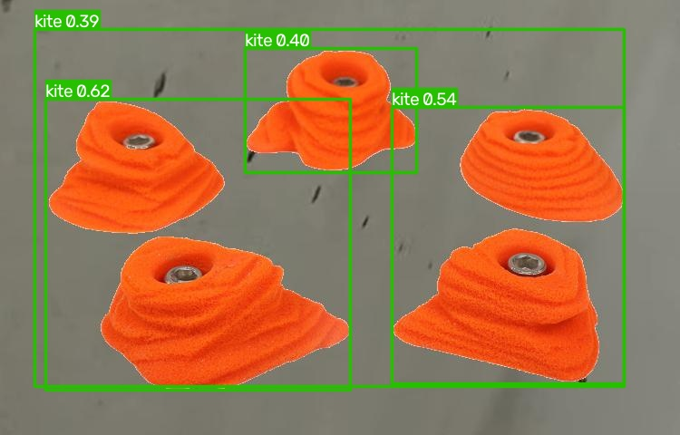
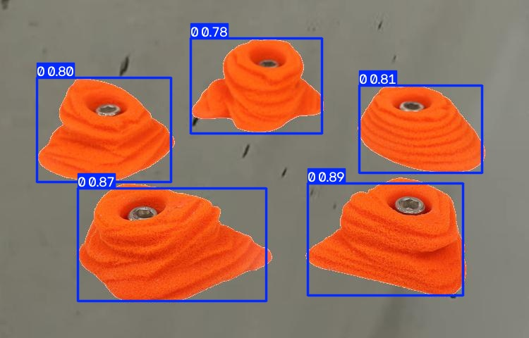

Oct 29.
DID: 
    - Decided on using :
        - YOLO26n model

        -  RoboFlow for Data Labelling
            - using annotated dataset from https://universe.roboflow.com/blackcreed-xpgxh/climbing-holds-and-volumes/browse?queryText=&pageSize=100&startingIndex=0&browseQuery=true 
                - v14 dataset for yolo26 (ClimbingHoldsV14)
            
                - .yaml tells tells yolo where images are located and which object classes it should recognize

                - labels describes the class_id, x_center, y_center, width, height of the annotation

                - training, validation, and final test, datatset (supervised learning)

    - yolo26n detection model for initial training on hold detection ran on 1.jpg
        
        

    - trained the yolo26n model with the annotated data set then ran on 1.jpg again
        
    
         
TO-DO: 
    - fix numbered run folders before next training run
    - train Model
    - test on new images
    - evaluate
    - improve dataset or conditions